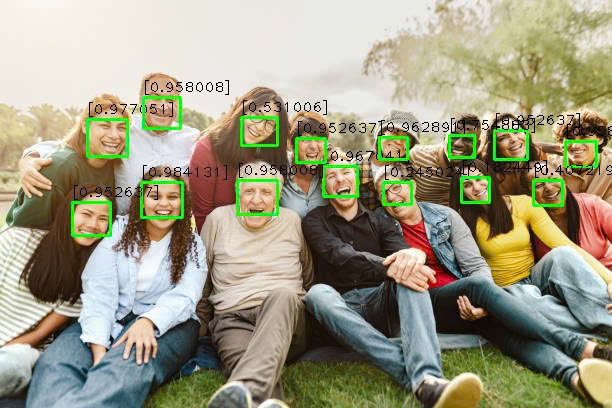

# Retinaface



This repository contains source code for the RetinaFace plugin and a demo face-detection application.

## Overview

- `retinaface.cpp`, `retinaface.h`: main RetinaFace model implementation.
- `mobilefacenet.cpp`, `mobilefacenet.h`: MobileFaceNet implementation.
- `include/mtcnn_faces.proto`: protobuf schema for output data.
- `model/`: model binaries and configuration files.
- `app/`: demo application `retinaface_detection` and plugin `mlmtcnnmetadisable`.

## Requirements

- CMake >= 3.5
- Protobuf
- OpenCV 4
- GStreamer 1.0
- glib-2.0
- json-c
- SDK libraries and includes for `mlengine`, `mlmeta`, `oclea_*`

## Project structure

- `CMakeLists.txt`: builds shared model plugins and protobuf library.
- `app/CMakeLists.txt`: builds demo app `retinaface_detection`.
- `model/`: contains binary model files for supported platforms like `cv28`.

## Build

From the repository root:

```bash
mkdir -p build
cd build
cmake -DPLATFORM=cv28 ..
make
```

To install directly into the SDK, set `ML_PLUGINS_IN_SDK` before running CMake:

```bash
export ML_PLUGINS_IN_SDK=1
cmake -DPLATFORM=cv28 ..
make
```

## Install

By default, binaries are installed to `../tsdk-ml-teknique-face/fakeroot/`.

When installing into the SDK, `INSTALL_PREFIX` is empty and libraries install to the SDK paths.

## Usage

- RetinaFace plugin: `mlmtcnnface`
- MobileFaceNet plugin: `mlmobilefacenet`
- Demo application: `retinaface_detection`

The demo app is built from `app/main.cpp` and links against the required model libraries.

## Notes

- Ensure `PLATFORM` is set correctly (for example: `cv22`, `cv25`, `cv28`, `cv2`).
- Model `.bin` files are installed to `usr/share/ml-models/retina_face`.
- Adjust include paths and dependencies in `CMakeLists.txt` to match your environment if needed.
